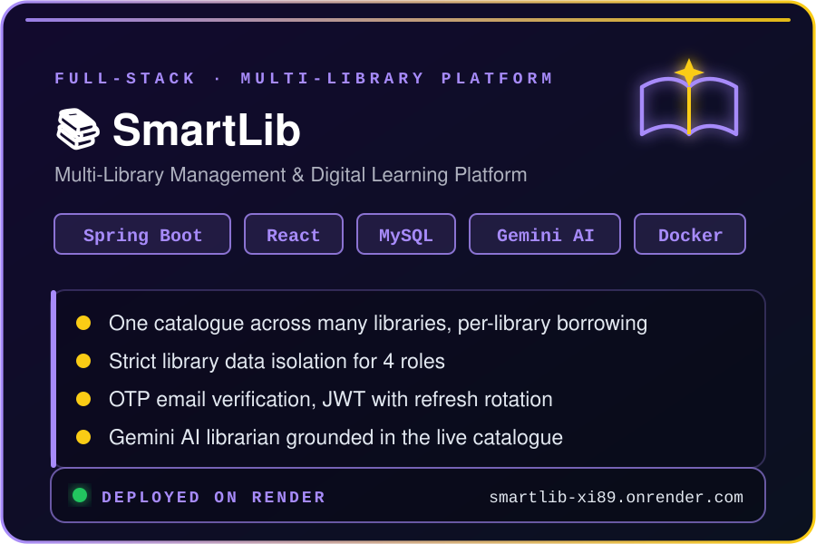
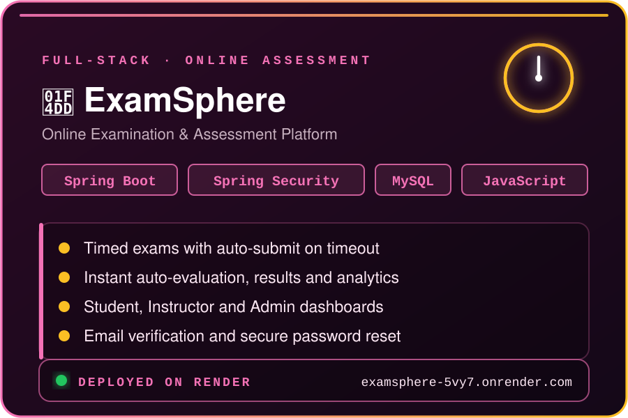
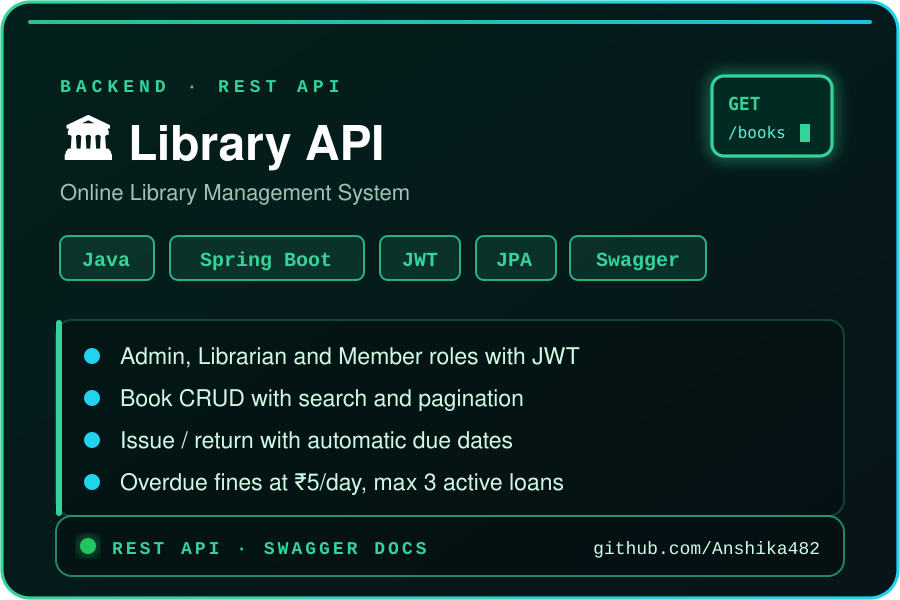
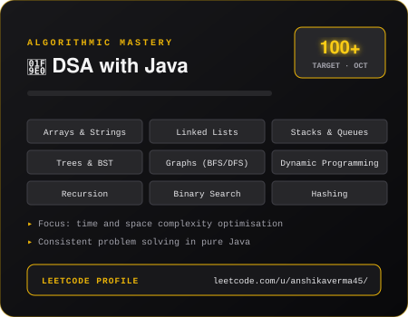

<p align="center">
  
</p>

<p align="center">
  
</p>

# ⚡ Who Am I ?
```dart
class AnshikaVerma extends Developer {

    final String role = "Software Developer";
    final String education = "B.Tech CSE • SRMCEM Lucknow • Class of 2027";
    final String location = "Lucknow, India 🇮🇳";

    final String[] craft = {
        "Backend development with Java & Spring Boot",
        "Full-stack apps with React and MySQL",
        "Problem solving with Java & DSA"
    };

    String currentMission() {
        return "Building secure, deployed software, one commit at a time 🚀";
    }

    String nextGoal() {
        return "Software development internships and full-time roles 🎯";
    }

    String superpower() {
        return "Turning complex requirements into clean, working systems ✨";
    }
}
```

<p align="center">
  <a href="https://www.linkedin.com/in/anshika-verma-ab1a97327">
    
  </a>
  <a href="mailto:anshikav2244@gmail.com">
    
  </a>
  <a href="https://leetcode.com/u/anshikaverma45/">
    
  </a>
</p>

---

# 🛠️ Tech Universe
<p align="center">
  
</p>

---

# 🛠️ Tech Stack

### Languages

<p>
  
</p>

### Frontend

<p>
  
</p>

### Backend

<p>
  
</p>

<p>
  
  
  
  
</p>

### Database & Cloud

<p>
  
</p>

<p>
  
  
</p>

### APIs & Authentication

<p>
  
  
  
  
  
  
</p>

### Tools

<p>
  
</p>

---

# 🚀 Featured Projects

<table>
<tr>
<td width="50%" valign="middle">

### 📚 SmartLib - Multi-Library Management Platform

A full-stack platform hosting many independent libraries: search every library at once, compare availability and borrow from the one you choose. Four roles with strict library-level data isolation, OTP email verification, fines with server-verified payments, and a Google Gemini AI librarian that answers from the live catalogue.

**Tech:** Java 21 · Spring Boot · Spring Security · MySQL · React · Gemini API · Docker

<br>

<b>Live Demo:</b> <a href="https://smartlib-xi89.onrender.com">SmartLib</a> · <b>Code:</b> <a href="https://github.com/Anshika482/SmartLib-Multi-and-Digital-Library">GitHub</a>

</td>

<td width="50%" align="center" valign="middle">
  <a href="https://smartlib-xi89.onrender.com">
    
  </a>
</td>
</tr>

<tr>
<td width="50%" align="center" valign="middle">
  <a href="https://examsphere-5vy7.onrender.com">
    
  </a>
</td>

<td width="50%" valign="middle">

### 📝 ExamSphere - Online Examination Platform

A full-stack examination platform for students, instructors and admins, with timed exams and auto-submit, instant auto-evaluation, result analytics, exam scheduling, and secure email verification and password reset.

**Tech:** Java · Spring Boot · Spring Security · JPA/Hibernate · MySQL · JWT · JavaScript

<br>

<b>Live Demo:</b> <a href="https://examsphere-5vy7.onrender.com">ExamSphere</a> · <b>Code:</b> <a href="https://github.com/Anshika482/ExamSphere-Online-Examination-Platform">GitHub</a>

</td>
</tr>

<tr>
<td width="50%" valign="middle">

### 🏛️ Library Management REST API

A Spring Boot REST API for books, members and issue/return workflows, with Admin, Librarian and Member roles, automatic due dates, overdue fines, loan limits, pagination and Swagger documentation.

**Tech:** Java · Spring Boot · Spring Security · Spring Data JPA · JWT · Swagger

<br>

<b>Code:</b> <a href="https://github.com/Anshika482/library-management">GitHub</a>

</td>

<td width="50%" align="center" valign="middle">
  <a href="https://github.com/Anshika482/library-management">
    
  </a>
</td>
</tr>
</table>

---

# 🧠 Data Structures & Algorithms

<p align="center">
  <a href="https://leetcode.com/u/anshikaverma45/">
    
  </a>
</p>

<p align="center">
  <b>Solving LeetCode problems in Java · on the road to 100+</b><br/>
  Arrays · Linked Lists · Stacks · Queues · Trees · Graphs · Recursion · Dynamic Programming · Binary Search · Hashing
</p>

---

# 📚 Computer Science Fundamentals

<p align="center">
  
  
  
  
  
</p>

---

# 🎓 Education

<p align="center">
  
</p>
<p align="center">
  
  
</p>
<p align="center"><sub>Rani Laxmi Bai Memorial School, Lucknow</sub></p>

---

# 📊 GitHub Statistics

<p align="center">
  
  
</p>

<p align="center">
  
</p>

---

# 🐍 Contributions

<p align="center">
  <picture>
    <source
      media="(prefers-color-scheme: dark)"
      srcset="https://raw.githubusercontent.com/Anshika482/Anshika482/output/github-contribution-grid-snake-dark.svg"
    />
    <source
      media="(prefers-color-scheme: light)"
      srcset="https://raw.githubusercontent.com/Anshika482/Anshika482/output/github-contribution-grid-snake.svg"
    />
    
  </picture>
</p>

---

# 💡 Developer Quote

<p align="center">
  <i>"Make it work, make it right, make it fast."</i>
</p>

---

# 🤝 Connect With Me

<p align="center">
  <a href="https://www.linkedin.com/in/anshika-verma-ab1a97327">
    
  </a>
  <a href="mailto:anshikav2244@gmail.com">
    
  </a>
  <a href="https://leetcode.com/u/anshikaverma45/">
    
  </a>
</p>
